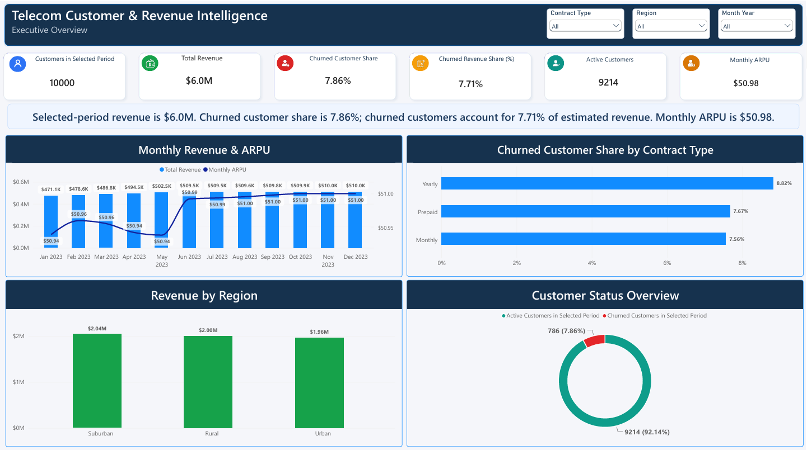
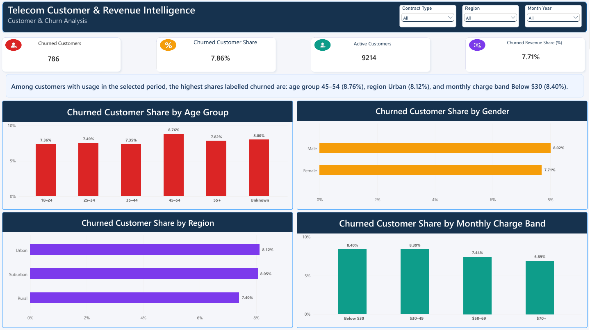
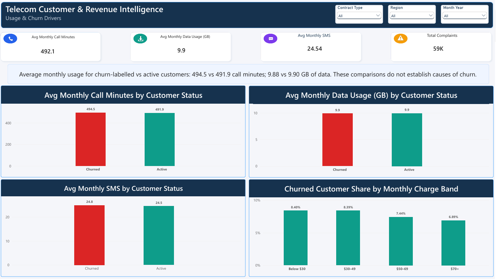

# Telecom Customer & Revenue Intelligence

A Power BI portfolio project exploring customer segments, estimated revenue, service usage, and the share of customers labelled churned. A companion Python notebook documents a churn modelling experiment and its limitations.

## Dashboard Preview

### Executive Overview

### Customer & Churn Analysis

### Usage & Churn Drivers

## Business questions

- How do estimated revenue and monthly ARPU vary across months and regions?
- Which customer segments have the highest share labelled churned?
- How does average monthly usage compare between churn-labelled and active customers?
- Do the tested customer and usage features support useful churn predictions?

## Dashboard pages

| Page | Focus |
| --- | --- |
| Executive Overview | Customer counts, estimated revenue, monthly ARPU, churned customer share, and revenue composition |
| Customer & Churn Analysis | Churn-labelled customer shares by age group, gender, region, and monthly charge band |
| Usage & Churn Drivers | Monthly usage comparisons by customer status and charge-band analysis |

“Drivers” is an exploratory page label. The comparisons do not establish causes of churn.

## Tools

Power BI Desktop, Power Query (M), DAX, Python, pandas, scikit-learn, and Google Colab.

## Data and cleaning

The project uses three supplied CSV files:

- `customer_info.csv`: customer details, monthly charges, and signup dates.
- `usage_data.csv`: monthly customer usage and complaints.
- `churn_labels.csv`: customer-level binary churn labels.

The raw customer file contained 10,200 records. Customer IDs and text fields were cleaned, records were sorted by signup date, and duplicates were reduced to one record per customer, retaining the earliest signup record.

Usage records were joined to customer signup dates. Records where the usage date preceded signup were excluded.

| Check | Result |
| --- | ---: |
| Unique customers | 10,000 |
| Original usage rows | 120,000 |
| Usage rows excluded before signup | 2,261 |
| Valid usage rows | 117,739 |
| Customers labelled churned | 786 |

Charge quality was classified as Invalid for negative charges, Review for charges above 200, and Valid otherwise. Revenue-share measures use the Valid charge subset. Missing ages remain visible as an Unknown group in the report; the modelling workflow imputes missing numeric values using training data only.

## Data model and metric definitions

The report uses `DimCustomer`, `DimDate`, and `FactUsage`. Customer and date dimensions filter the usage fact table through single-direction relationships. The usage grain is one customer per month.

- **Customers in Selected Period:** distinct customer IDs with usage in the filtered period.
- **Churned Customer Share:** churn-labelled customers with usage in the period divided by all customers with usage in that period.
- **Revenue estimate:** monthly customer charges summed over eligible customer-month usage rows. This is an estimate rather than invoiced revenue.
- **Monthly ARPU:** the revenue estimate divided by the number of customer-month usage rows.
- **Churned Revenue Share:** the share of estimated revenue attributable to churn-labelled customers, restricted to Valid charge records.
- **Average monthly usage:** usage averaged across customer-month rows, rather than an equal-weighted average of customer-level averages.

Churn labels have no event date. Selecting a month changes the usage cohort; it does not measure churn events occurring during that month. “Active” represents label 0 in this dataset.

## Findings with all slicers set to All

| Metric | Displayed result |
| --- | ---: |
| Customers | 10,000 |
| Churn-labelled customers | 786 |
| Active customers | 9,214 |
| Churned customer share | 7.86% |
| Estimated revenue, rounded | $6.0M |
| Monthly ARPU | $50.98 |
| Churned revenue share | 7.71% |

The largest displayed churn-labelled shares were age group **45–54 (8.76%)**, **Urban (8.12%)**, and monthly charge band **Below $30 (8.40%)**. These are separate segment comparisons, not one combined customer profile.

Average monthly call minutes were **494.5 for churn-labelled customers versus 491.9 for active customers**. Average data usage was **9.88 GB versus 9.90 GB**. The displayed differences are small and do not establish causation or statistical significance.

Dollar notation follows the report's presentation; the estimates are not verified operator financial results.

## Churn modelling experiment

The Colab notebook creates one row per customer using customer details, observed-month counts, average call minutes, average data usage, and complaint summaries.

A stratified split reserves 8,000 customers for training and 2,000 for testing. The training set contains 629 churn-labelled customers; the test set contains 157. Negative monthly charges are treated as missing. Imputation, scaling, and category encoding are learned from training data only. Customer IDs and the target label are excluded from predictors.

| Evaluation | ROC-AUC | Average precision |
| --- | ---: | ---: |
| Logistic Regression: held-out test set | 0.505 | 0.085 |
| Random Forest: mean of 3 training cross-validation folds | 0.494 | 0.081 |

The test churn prevalence was approximately 0.079. Logistic Regression predicted every test customer as not churned at its default decision threshold. Its 92% accuracy therefore concealed zero recall for churned customers.

A training-only diagnostic comparing recent three-month usage with the preceding three months showed similar average changes in both label groups. These trend variables were inspected diagnostically; they were not included in the reported model fits.

**Decision:** the tested features and models did not demonstrate useful predictive performance. Prediction scores and high-risk customer lists were not added to Power BI. This does not establish that every possible feature or model would fail.

## Limitations and further work

- Confirm the timing and meaning of churn labels relative to the usage observation period before claiming future churn prediction.
- The customer split tests discrimination across customers, not performance on a future time period.
- Static monthly charges do not capture billing changes, discounts, or realized collections.
- Investigate additional predictors and label quality before further model development.
- Use validation within training data for future feature selection and tuning; preserve an independent final evaluation set.

## Open and reproduce

1. Open the project's `.pbix` file in Power BI Desktop.
2. To refresh, update the three CSV source paths in Power Query to your local data folder.
3. Use the PDF for a static view of all three dashboard pages.
4. Open `Telecom_Churn_Model.ipynb` in Google Colab.
5. Run notebook cells from top to bottom and upload the three CSV files when prompted. A runtime reset requires reloading the files and rerunning the cells.

Keep the PBIX, exported PDF, notebook, and this README together. Obtain the original CSVs from their source and record the source URL and applicable reuse terms before redistributing the data.

## Project scope

Delivered: three descriptive Power BI pages and a documented ML experiment. A validated churn prediction or retention recommendation system is not part of this release.

